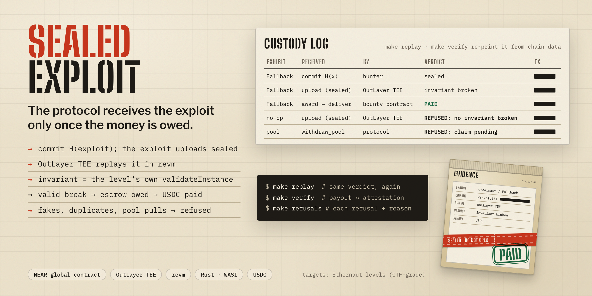
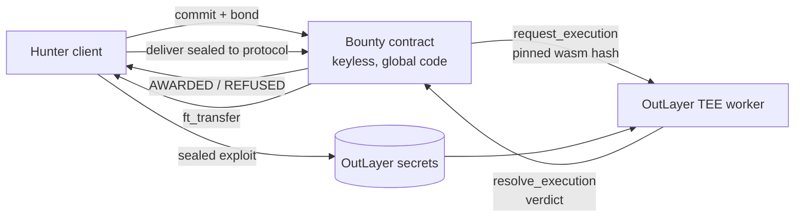

<div align="center">
  
  <h1>Sealed 🔒</h1>
  <p><em>Bug bounties that pay for an executed break of a committed invariant on a committed snapshot — before the protocol ever sees the exploit.</em></p>
  

  **Proof, not a pitch:** on NEAR testnet the verifier paid **5 of 5** real Ethernaut exploits and **0 of 21** submitted fakes. Re-check it yourself, no NEAR account or key: `make replay` (offline) and `make verify` (from chain data).

  <br/>

  [](https://nearhackathon.com)

  <br/>

  
  
  
  
  [](LICENSE)

</div>

---

## 📸 See it in Action

The hero above is the artwork; the product is the command line and the chain. Start with the five-minute path in
[DEMO.md](DEMO.md): one real exploit pays out, one fake is refused with a reason, both with explorer links.

## 💡 The Problem & Solution

### The Problem

Bug bounties are trust-first: the hunter reveals the bug, then a human triager decides whether and how much to pay. The
protocol can patch it, call it "known" and pay nothing, and AI-written "exploit reports" bury the triage queue.

### The Solution

A bounty account that nobody holds a key to commits three things at funding: the snapshot hash, the invariants, and the
hash of the verifier WASM. Then:

1. The hunter **commits** `H(exploit ‖ hunter ‖ salt)` with a bond and stores the exploit as an OutLayer encrypted secret.
2. The contract asks **NEAR OutLayer** to run the pinned verifier in a TEE worker. The verifier replays the exploit in
   revm on the snapshot and calls the level's own `validateInstance`.
3. The callback **awards** the first commit that verifies, once per invariant. Everything else is **refused on chain with
   a reason**, and a hunter-caused failure slashes the bond.
4. The hunter **delivers** the exploit sealed to the protocol's key. The contract checks it hashes to what the worker
   attested, and only then is the escrow owed and **paid**. The protocol gets exactly the exploit that was verified
   (`make open` opens all 6 paid deliveries offline to the exploit `make replay` re-runs).

The protocol still decides what counts as a break, but before any bug exists and in public.

## 🏗️ Architecture & Tech Stack



| Layer | Choice |
|---|---|
| Verifier | Rust → WASI (`verifier.wasm`), revm, 5 Ethernaut snapshots at commit `d05643a4` |
| Contract | near-sdk 5.9.0, NEP-141 escrow, NEAR global contract, zero access keys |
| Execution | NEAR OutLayer TEE workers (documented as Intel TDX; this repo checks the worker key, not the quote), pinned by wasm hash |
| Tooling | Python 3 scripts, `wasmtime`, archival RPC (FastNEAR) |

Full walk-through with `file:line` for every claim: [ARCHITECTURE.md](ARCHITECTURE.md).

## 🏆 NEAR OutLayer Integration (Security track; Privacy, Agents and Open fits)

| OutLayer method | Used for | Code |
|---|---|---|
| `request_execution` | the bounty requests the verifier, pinned by hash, with the hunter's secrets profile | `contracts/bounty/src/lib.rs:334` (call), `:657` (hash pin) |
| `resolve_execution` | the worker's call resumes the yield into `on_verdict`, which decides AWARDED or REFUSED | `contracts/bounty/src/lib.rs:343` |
| `store_secrets` | the hunter stores the exploit as an OutLayer encrypted secret bound to the pinned wasm hash | `scripts/hunter.py:63-76` |
| `get_config` | `make verify` anchors the worker to OutLayer's operator at the resolve block | `scripts/verify.py:107` |
| Global contracts | the bounty runs on a code hash with no access key (I6); the earlier D3 throwaway bounty (2 of the 29 runs) is keyed | `scripts/deploy_bounty_testnet.py:115` |

## ⛓️ Live Deployment

Testnet only; no wallet is needed to check any of it. Every hash is in `corpus/results.json`.

| Item | Value |
|---|---|
| Demo bounty (5 levels, keyless) | `demo.sealed-dev-11010702.testnet` · create tx `9FrSN6h6gnuTaqHnzy4AjGoYCfzJkhHeDKpG4wcdDpTU` |
| Corpus bounty (fakes) | `corpus.sealed-dev-11010702.testnet` · create tx `GWgM5NCLY75JQyUhnRXXaP1Uhs49aUYM3hxLocpuoRou` |
| Global code hash | `7HtmeswBuR9JLCcU31QCioUGEmudjyYrNcbAr1jghRUv` |
| A real exploit, PAID | [commit](https://testnet.nearblocks.io/txns/FNbCUc53YNayqd6NBqaaxnZTeGAVGABHfPsoHz7Gkc2s) · [worker verdict](https://testnet.nearblocks.io/txns/2vdtrvQmZmpt4NGfAD2FyBQy9d5PjLR4dEJuQCF8MXTX) · [deliver](https://testnet.nearblocks.io/txns/AodmFQ6tq4pBcxLreRDSCanKkZQY7m6nhM459NfPAg3s) |
| A fake, REFUSED | [`fake`](https://testnet.nearblocks.io/txns/DUtubHScU3udGH58UxdTHWjwvDBjsHCsrupmBMxVYZiy): "no invariant broken", bond slashed |
| Refusal kinds on chain | 6 of 6: `make refusals` lists each tx |

## 📊 Engineering Rigor

| Metric | Value | Where |
|---|---|---|
| Real exploits paid / submitted | 5 of 5 (demo bounty) | `corpus/results.json` |
| Non-breaking submissions paid | 0 of 21 (21 of 21 refused; the 21 that ran on the demo and corpus bounties) | `corpus/results.json` |
| Corpus | 52 items vs golden verdicts | `make corpus` |
| Tests | 34: 11 verifier golden, 3 contract unit, 20 near-workspaces sandbox | `make test` |
| Request → verdict | p50 7.27 s · p95 10.85 s (29 runs) | `corpus/bench.json`, `make bench` |
| Heaviest real run | 7 371 260 instructions (0.37% of the 2e9 limit) | `corpus/results.json` |
| Heaviest fake | 479 555 711 instructions (23.98% of the limit) | `corpus/bench.json` |
| LLM-only triage on the same corpus (fakes paid, of 21) | muse-wonder-1.0 1 · nemotron-3-ultra 3 · qwen3.8-omni-flash 3; the same models paid 12, 12 and 11 of the 15 real exploits | `make baseline` |

The baseline models could not run code and are **not** NEAR AI Cloud; read its limits in
[baseline/README.md](baseline/README.md) before quoting it.

### Attacks defeated

| Control | Why it is load-bearing | Test |
|---|---|---|
| I1 conservation | pool + escrow + paid = funded − withdrawn after every call | `contracts/itests/tests/bounty.rs:165` |
| I2 one payout per invariant | a duplicate commit cannot be paid twice | `bounty.rs:574`, `:486` |
| I2b reservation released | a refused fake frees its reservation and reopens the invariant | `bounty.rs:257` |
| I3 one verdict in flight | no race for the same invariant | `bounty.rs:363` |
| I4 withdraw guard | the protocol cannot pull reserved or awarded USDC | `bounty.rs:383` |
| I7 award matches the commit | a verdict for another exploit, invariant or snapshot is refused | `bounty.rs:279`, `:298`, `:318` |
| I8 delivery hash | the protocol gets the exploit only when `sha256(enc) == h_enc` | `bounty.rs:209` |
| Failed payout | a failed `ft_transfer` leaves the escrow owed and `retry_payout` pays it | `bounty.rs:436` |
| Fake exploits | a no-op, near-miss, wrong snapshot or abuse input is refused | `make corpus`, `verifier/tests/golden.rs` |

The sandbox tests run the contract against a mock OutLayer and a mock token; the live worker is shown by the testnet runs
(`make verify`).

### Honest limits (7)

1. **Testnet only.** The mainnet leg is prepared (`scripts/mainnet_leg.py`) and has not run.
2. **Worker attestation.** `make verify` shows the request pinned the verifier hash and the operator's OutLayer worker
   key (scoped to `resolve_execution`) answered. It checks the key, not its TDX quote, and does not show the worker ran
   exactly those bytes. `make replay` re-runs the same bytes locally.
3. **RPC trust.** `make verify` believes the archival RPC it queries; an RPC error becomes RECORDED (`verify.py` exit 2, `make` prints `Error 2`), never a pass.
4. **Baseline models** are third-party, not NEAR AI Cloud, one run each, with a hunter claim on only 5 of the 21 fakes.
5. **Stuck commits.** The dangling-`Pending` refund branch is covered by code review only, and the yield-timeout path was
   not observed on a live testnet run.
6. **Storage and griefing.** Commits are stored for good and paid from the bounty's NEAR balance; fresh accounts can keep
   one invariant busy for the cost of gas and the OutLayer fee.
7. **No outside users yet.** The measured demo is our own hunter agent plus the fakes corpus.

Detail for each, plus memory and seal-key reuse: [ARCHITECTURE.md § Limits](ARCHITECTURE.md#limits).

## 🚀 Getting Started

### Prerequisites

`python3` ≥ 3.8 and `wasmtime` (`brew install wasmtime`, `cargo install wasmtime-cli`, or `curl https://wasmtime.dev/install.sh -sSf | bash`). Rust is
only needed to rebuild the verifier from source (`make verifier-check`).

### Reproduce from a fresh clone (no NEAR account, no keys)

| Do this | See this | Network |
|---|---|---|
| `make doctor` | prerequisites present, `verifier.wasm` hash matches its pin | archival RPC ping |
| `make replay` | every published commit re-run under wasmtime from the committed wasm its bounty pinned (sha256-checked) = its on-chain verdict | none |
| `make replay INPUT=corpus/vectors/real-fallback.json` | the verdict for one tx list (yours: `{"target":0,"invariant_id":"…","txs":[…]}`) | none |
| `make open` | all 6 paid deliveries opened offline: `sha256(enc)` = the verdict's `h_enc`, the box opens to the exploit `make replay` re-runs, and it hashes to the commit (needs PyNaCl) | none |
| `make verify` | each of the 29 runs proven from chain data: pinned hash, the operator's scoped worker key, verdict, `h_enc`, PAID; every commit on chain bundled; paid totals match | archival RPC, about 80 calls (a few minutes on a rate-limited node; `Error 2` = unreachable, `Error 1` = a failed check) |
| `make verify-demo` | the same checks on the 5 paid demo-bounty runs, and FAIL unless that bounty has 0 access keys and runs the committed `contracts/bounty.wasm` (global hash `7Htmes…`) | about 25 calls (about 1.5 min) |
| `make corpus` | all 52 corpus items vs their golden verdicts | none |
| `make refusals` | the 6 on-chain refusal kinds with tx hashes | none |
| `make bench` | request→verdict p50/p95, instructions / time / memory vs the enforced limits | none (`make bench-chain` re-reads the chain) |
| `make baseline` | what LLM-only triage would pay on the same corpus | none |

## 🧪 Testing & CI

```bash
make test          # verifier golden + contract unit + near-workspaces sandbox (needs Rust, wasm-opt)
make corpus        # 52 items vs golden verdicts, wasmtime only
```

`.github/workflows/ci.yml` runs five jobs: verifier golden tests; a byte-for-byte rebuild of `verifier.wasm` on macOS/arm64 (the pinned build host; a Linux rebuild lays out data differently, so its bytes differ and that leg is informational); the
credential-free `replay`/`corpus`/`refusals`/`results`/`bench` targets; the contract unit and sandbox tests (I1–I8);
and `scripts/check_submission_readiness.py` with gitleaks over the full history. CodeQL (Python, Rust) and Dependabot are
configured in `.github/`. Developer-experience notes on OutLayer and global contracts: [docs/DX-REPORT.md](docs/DX-REPORT.md).

## 📁 Project Structure

```
verifier/       WASI verifier (revm) + 5 Ethernaut snapshots      contracts/   bounty + test token + sandbox tests
levels/         pinned Ethernaut sources                           scripts/     hunter, verify, replay, bench, baseline
corpus/         52-item corpus, evidence bundles, results, bench   baseline/    LLM-only triage record
hunter-agent/   LLM-hunter transcripts and proposed exploits       day0/        feasibility checks
```

## 🗺️ Roadmap

- [x] Keyless bounty on a NEAR global contract, verifier pinned by hash
- [x] 5 Ethernaut levels, 52-item corpus, 6 refusal kinds on chain
- [x] `make replay` and `make verify` from a fresh clone
- [ ] Mainnet leg (script prepared, a human signs)
- [ ] LLM baseline and hunter on NEAR AI Cloud (needs the key)

## 📽️ Demo Materials

Walk-through with explorer links: [DEMO.md](DEMO.md). Landing page: [sealed-exploit.vercel.app](https://sealed-exploit.vercel.app)
(source `docs/index.html`; it replays two recorded testnet runs). Pitch deck: [/pitch/](https://sealed-exploit.vercel.app/pitch/)
(`docs/pitch/index.html`). A video is not published yet.

## 📄 License

MIT — see [LICENSE](LICENSE).

## 🙏 Acknowledgments

Levels from [OpenZeppelin Ethernaut](https://github.com/OpenZeppelin/ethernaut) · execution on [NEAR OutLayer](https://app.outlayer.ai) · EVM by [revm](https://github.com/bluealloy/revm).
